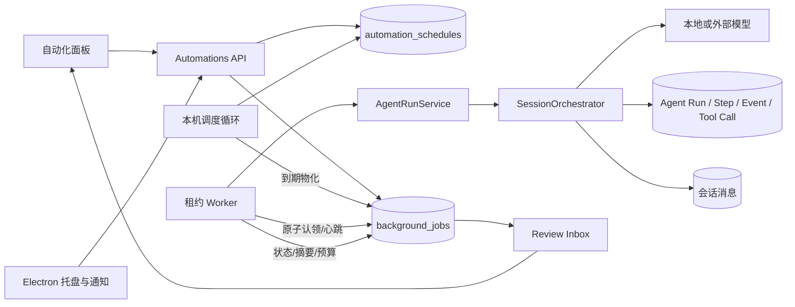

# AetherChat 第二阶段：持久后台任务与定时自动化

日期：2026-08-01

阶段：Claude Desktop / Cowork 对标第 17 批

实现范围：本机后台 Job、单次/循环调度、SQLite 租约、崩溃恢复、只读权限快照、预算上限、Review Inbox、系统托盘与通知

## 1. 阶段结论

AetherChat 的 Agent Run 已从“由前台 WebSocket 临时驱动”扩展为两条并存的执行通道：

1. 前台会话继续支持流式输出、运行中转向、交互授权和中断；
2. 后台调度器可以在聊天窗口隐藏后独立创建和恢复 Agent Run，并把结果持久化到原会话、运行审计和后台复核收件箱。

本阶段复制的是 Claude Cowork 公开的定时任务与后台工作范式，而不是 Claude 的实现代码。AetherChat 采用本机 SQLite、显式租约和只读默认策略，适配其本地多模型、MCP、插件、沙箱和 Agent Run 架构。

## 2. 用户可见能力

### 2.1 自动化面板

活动栏新增“自动化”入口，支持：

- 创建单次任务；
- 创建按分钟循环的任务，最短间隔 5 分钟；
- 设置首次执行时间、本机时区、目标模型和单次美元预算上限；
- 暂停、启用、删除或立即运行；
- 查看下一次运行、最后状态、错误和预算消耗；
- 从后台 Job 进入完整 Agent Run 审计；
- 将已完成、失败或取消的结果标记为已复核。

### 2.2 窗口关闭后的行为

- 点击窗口关闭按钮时，AetherChat 隐藏到系统托盘；
- Electron 主进程、本机 FastAPI 后端和调度器继续运行；
- 托盘菜单可重新打开工作台、进入快速输入或完全退出；
- 后台结果新增时显示本机通知，并通知已打开的渲染器刷新消息和运行记录；
- 从应用菜单或托盘选择“退出”才会执行完整关停。

完全退出或操作系统结束进程后不会偷偷执行任务。正在运行的任务会保存为可恢复状态并回到队列；下次启动后由租约恢复机制接管。

## 3. 架构



### 3.1 数据层

`automation_schedules` 保存：

- 会话、名称和执行指令；
- `once` / `interval` 触发类型；
- 间隔、时区、下一执行时间和启用状态；
- 模型目标；
- 单次预算上限；
- 创建时固化的权限快照；
- 最近执行时间、状态和错误。

`background_jobs` 保存：

- 关联 Schedule、Session 和 Agent Run；
- `schedule` / `manual` 实际触发来源；
- 排队、运行、待复核、完成、失败、取消状态；
- 不可变的 Action 和权限快照；
- 计划执行时间、尝试次数和 Worker 租约；
- 执行摘要、错误、预算使用和人工复核时间；
- 开始、完成和更新时间。

同一 Schedule 和计划时间具有唯一约束。调度循环重复扫描同一到期点时不会生成重复 Job。

### 3.2 到期和补跑策略

- 单次任务到期后物化一个 Job，并自动停用；
- 循环任务到期后只物化一个追赶 Job；
- 若应用离线跨过多个周期，不会一次性制造任务洪峰；
- 下一时间直接推进到当前时间之后的第一个周期；
- 用户仍可通过“立即运行”显式增加一个手动 Job。

### 3.3 租约与恢复

Worker 使用 SQLite `BEGIN IMMEDIATE` 原子认领 Job，并写入：

- 随机 Worker ID；
- 租约截止时间；
- 尝试次数；
- 首次开始时间。

运行期间每个租约周期执行心跳。新 Worker 只能接管已过期租约，避免两个进程同时执行同一 Job。恢复时：

- 已完成 Agent Run 不重复执行；
- `failed`、`interrupted`、`recoverable` Run 使用原有 checkpoint 和幂等工具记录重试；
- 连续接管超过 3 次后进入失败收件箱，防止永久崩溃循环；
- 已确认过结果的副作用工具仍遵守现有幂等保护；不确定副作用不会自动重放。

## 4. 权限和安全边界

### 4.1 默认只读

当前桌面 UI 只允许创建 `read_only` 自动化。权限快照固定为：

```json
{
  "policy_version": 1,
  "mode": "read_only",
  "allowed_tools": [],
  "captured_at": "<UTC timestamp>"
}
```

该快照随每个 Job 复制，之后即使普通聊天获得了临时会话授权，后台任务也不会继承。

### 4.2 双重拒绝

1. 编排器在发送模型请求前，从工具定义中移除未授权的副作用工具；
2. 若模型仍伪造工具调用，执行器会在真正调用前再次判断并记录 `denied` 结果。

因此无人值守任务当前不能：

- 写入工件或本机文档；
- 运行命令；
- 控制电脑；
- 打开外部链接；
- 调用默认视为有副作用的 MCP 工具；
- 修改任务、合并或项目状态；
- 启动 ComfyUI 生成任务。

它可以读取会话、项目知识、只读工件和明确标记为只读的本机能力，并生成保存于会话数据库中的自然语言结果。

### 4.3 预算

每个 Job 创建独立 Orchestrator，并把用户设置的 `max_budget_usd` 作为本次预算余额。模型成本更新会累计为 `budget_spent_usd`，随 Job 保存并显示。

## 5. 实际输出

后台任务完成后不会只留下“模型声称完成”。系统实际输出包括：

| 输出 | 保存位置 | 用途 |
|---|---|---|
| 最终回答 | `messages` | 回到原会话继续阅读 |
| Run/Step/Event | Agent Run 表 | 查看编排过程和状态机 |
| Tool Call/Result | Agent 工具调用表 | 区分成功、拒绝、失败和不确定结果 |
| Job 状态 | `background_jobs.status` | 排队、运行、完成、失败、取消 |
| 结果摘要/错误 | `summary` / `error` | Review Inbox 快速判断 |
| 权限快照 | `permission_snapshot_json` | 证明无人值守执行边界 |
| 预算 | `max_budget_usd` / `budget_spent_usd` | 成本上限和实际用量 |
| 租约/尝试 | `lease_*` / `attempt` | 恢复和重复执行审计 |
| 复核时间 | `reviewed_at` | 区分新结果与已处理结果 |

## 6. API

| 方法 | 路径 | 作用 |
|---|---|---|
| `GET` | `/automations/status` | 调度器、队列和待复核计数 |
| `GET` | `/automations/schedules` | 当前会话定时任务 |
| `POST` | `/automations/schedules` | 创建只读单次/循环任务 |
| `PATCH` | `/automations/schedules/{id}` | 更新、暂停或启用 |
| `DELETE` | `/automations/schedules/{id}` | 删除 Schedule，保留历史 Job |
| `POST` | `/automations/schedules/{id}/run` | 立即生成手动 Job |
| `GET` | `/automations/jobs` | 后台 Job 与 Review Inbox |
| `POST` | `/automations/jobs/{id}/cancel` | 取消排队或运行中的 Job |
| `POST` | `/automations/jobs/{id}/review` | 标记结果已复核 |

所有端点继续使用 AetherChat 本机 Bearer Token / Desktop Token 保护，并按 Session ID 做归属校验。

## 7. 验证结果

| 门禁 | 结果 |
|---|---:|
| 后端 pytest | 101 passed / 1 skipped |
| Ruff | passed |
| Mypy | 51 source files passed |
| 前端生产构建 | passed |
| Electron 单元测试 | 10 passed |
| Chromium E2E | 39 passed |

新增拒绝和恢复测试覆盖：

- 只允许 `read_only`，拒绝 `full_access`；
- 同一到期点不会重复物化；
- 跨多个周期只生成一个追赶 Job；
- 过期租约由新 Worker 接管；
- 权限快照随 Job 固化；
- 模型伪造写文件工具调用仍在执行前拒绝；
- 手动 Job 完成后进入 Review Inbox 并可标记已复核；
- 中英文自动化主路径和无障碍既有门禁通过。

## 8. 当前边界与下一批

本阶段暂未把 AetherChat 安装成独立系统守护进程。选择“完全退出”后不会继续使用 CPU、模型或网络；下次启动再恢复，这是当前更透明的本机安全边界。

下一批建议按顺序继续：

1. 基于已注册 Git 仓库的受限 `file-change` 触发器，使用相对路径、去抖和内容哈希；
2. 可审阅的工具级预授权模板，而不是笼统“完全访问”；
3. 独立的失败/待确认/已完成收件箱筛选与批量归档；
4. 分层 `AGENTS.md`、Rules 和版本化 Skills；
5. OpenTelemetry traces、metrics 和本机诊断导出。

## 9. 对标依据

- [Claude Cowork 定时任务](https://support.claude.com/en/articles/13854387-schedule-recurring-tasks-in-claude-cowork)
- [Claude Cowork 架构概览](https://support.claude.com/en/articles/14479288-claude-cowork-architecture-overview)
- [Claude Cowork 多端与后台工作](https://support.claude.com/en/articles/15520349-use-claude-cowork-on-web-desktop-and-mobile)
